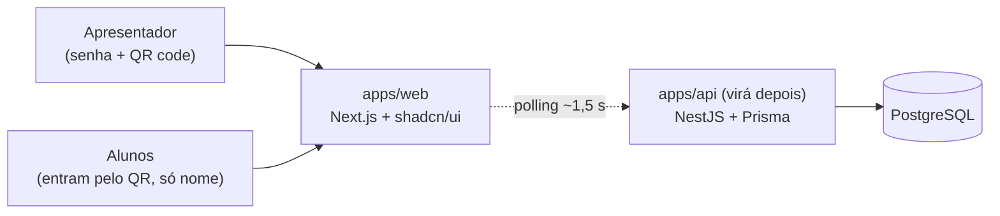
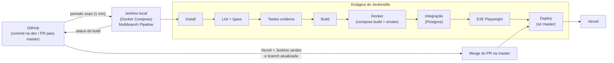

## Aplicação

- A API concentra as regras de negócio (estados da sessão, voto único) e expõe REST para sessão, gatos, participantes e votos.
- Tempo real por **polling**, sem WebSocket.
- Identidade do aluno: nome + cookie anônimo.
- Banco: PostgreSQL hospedado (Neon / Vercel Postgres); em dev local, via Docker Compose.
- Hospedagem da API: a definir. O front vai na Vercel com Root Directory `apps/web`.

## Pipeline CI/CD

- Os estágios seguem a ordem prevista em [pipeline.md](pipeline.md). Já existem Install, Lint + types, Build e Docker.
- Install = checkout + `pnpm install --frozen-lockfile` (o `corepack enable` fica na imagem do Jenkins). Integração sobe o Postgres no Docker Compose. O E2E cobre apresentador + aluno.
- O Jenkins roda em Docker Compose ([`jenkins/`](../jenkins/)), configurado como código (JCasC + Job DSL), e usa o Docker do host pelo socket.
- O Jenkins devolve ao GitHub o status `continuous-integration/jenkins/branch`. A `master` só aceita PR com os checks `Vercel` e do Jenkins passando e a branch atualizada, conforme [branches.md](branches.md).
- O `ignoreCommand` em `apps/web/vercel.json` evita deploy quando só mudam arquivos `.md` ou fora de `apps/web`.
- Se o deploy será disparado pelo Jenkins (Vercel CLI) ou só pela integração Git da Vercel: a definir.
