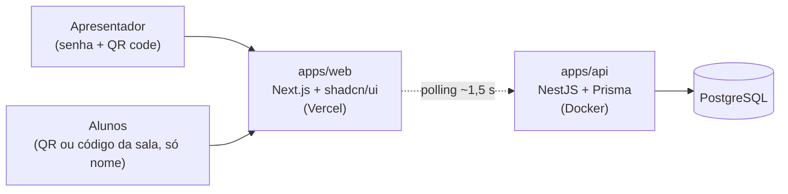
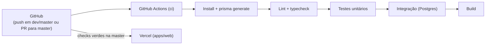

# Arquitetura

## Aplicação

- A API concentra as regras de negócio (estados da sessão, voto único) e expõe REST para sessão, gatos, participantes e votos.
- Tempo real por **polling**, sem WebSocket.
- O navegador só fala com o `web`; o Next repassa `/api/*` e `/cats/*` para a API (ver [api.md](api.md)).
- Identidade do aluno: nome + `participantId` guardado no navegador (`localStorage`).
- Banco: PostgreSQL. A sala vive em memória na API e é gravada no banco a cada ação (snapshot), então sobrevive a um reinício.
- Deploy: `apps/web` vai na Vercel (Root Directory `apps/web`) e `apps/api` + `postgres` sobem via Docker Compose (`docker compose up -d --build api`).

## CI

- Workflow em [`.github/workflows/ci.yml`](../.github/workflows/ci.yml).
- Proteções da `master`: [branches.md](branches.md).
