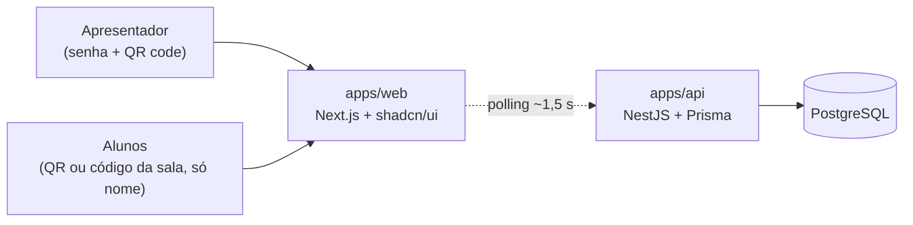
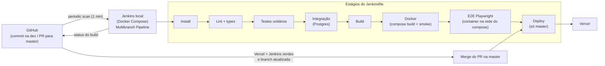

# Arquitetura

## Aplicação

- A API concentra as regras de negócio (estados da sessão, voto único) e expõe REST para sessão, gatos, participantes e votos.
- Tempo real por **polling**, sem WebSocket.
- O navegador só fala com o `web`; o Next repassa `/api/*` e `/cats/*` para a API (ver [api.md](api.md)).
- Identidade do aluno: nome + `participantId` guardado no navegador (`localStorage`).
- Banco: PostgreSQL. A sala vive em memória na API e é gravada no banco a cada ação (snapshot), então sobrevive a um reinício. Hoje roda no Docker Compose; hospedado (Neon / Vercel Postgres) só se a API sair do notebook.
- Hospedagem da API: a definir. O front vai na Vercel com Root Directory `apps/web`.

## Pipeline CI/CD

- Estágios, Jenkins local e integração com o GitHub: [pipeline.md](pipeline.md). Proteções da `master`: [branches.md](branches.md).
- Quem dispara o deploy (Jenkins com Vercel CLI ou só a integração Git da Vercel): a definir.
